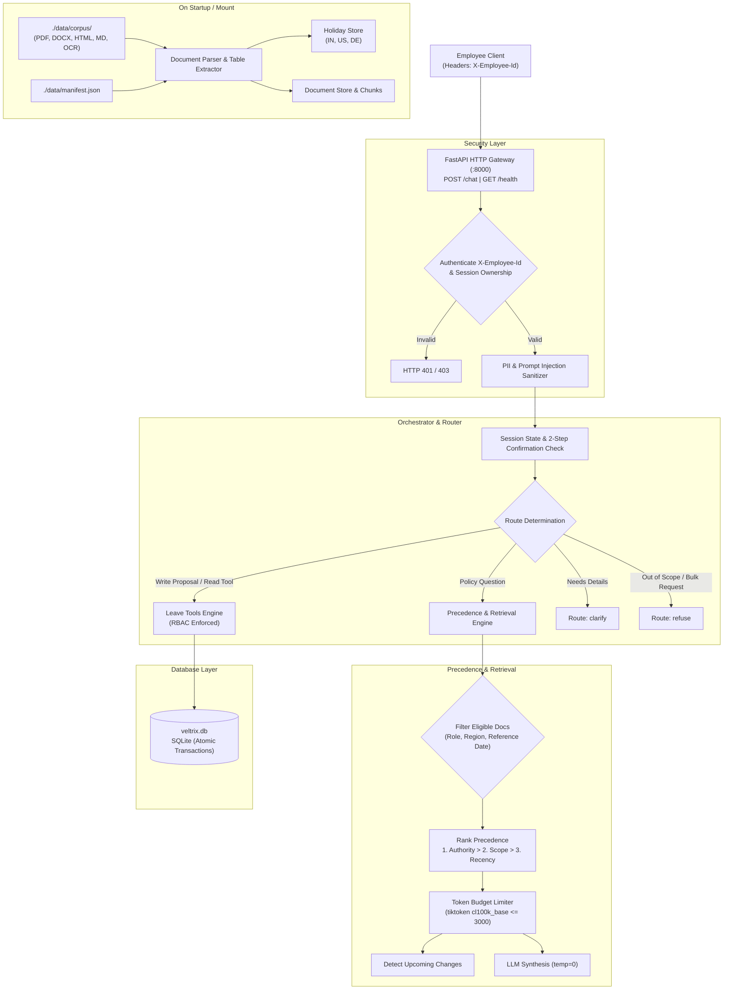

# Veltrix PeopleOps Assistant

An intelligent, secure, and policy-aware HR Assistant for Veltrix Systems. It answers employee questions from the HR policy corpus with precise citations, enforces strict document precedence and role-based access control (RBAC), and manages leave operations through atomic tools with two-step write confirmations.

---

## 🏗️ Architecture Overview

The following Mermaid diagram illustrates the end-to-end request lifecycle, ingestion pipeline, access control boundaries, and tool execution state machine.



---

## 🚀 How to Set Up and Run

### 1. Running with Docker Compose (Recommended)

To run the entire service inside Docker with zero manual setup:

```bash
# Clone the repository and enter the directory
cd veltrix-assistant

# Start the service (builds venkataravi456/veltrix-assistant:latest)
docker compose up --build
```

- Image tag: `venkataravi456/veltrix-assistant:latest`
- The service listens on port `8000`.
- Automatic ingestion runs immediately on startup.
- Verify readiness:
  ```bash
  curl http://localhost:8000/health
  # Returns: {"status": "ok"}
  ```

### 2. Interactive Web UI (ChatGPT-Style)
Open **http://localhost:8000** in your browser. The Web UI provides:
- **All 36 Real Employees**: Dropdown selector with complete role and regional classification (`IN`, `US`, `DE`).
- **Live RBAC Permissions Card**: Shows current employee's document and leave data access boundaries and direct reports.
- **Section 9.1 API Inspector**: Expandable `{ } API JSON` drawer on every response proving exact schema compliance (`request_id`, `route`, `citations`, `tool_calls`, `pending_confirmation`).
- **Interactive 2-Step Confirmation**: Inline `[ ✅ Confirm ]` and `[ ❌ Discard ]` action cards.
- **Evaluation Test Chips**: One-click assessment scenario tests for policy precedence, leave tools, RBAC refusals, and edge cases.
- **LangChain Integration**: Built with LangChain `Document` schemas, `ChatPromptTemplate`, and `StrOutputParser`.

#### Optional: Push or Pull from Docker Hub
If you want to push this image to your Docker Hub repository:
```bash
docker push venkataravi456/veltrix-assistant:latest
```
To run the pre-built image directly on any machine:
```bash
docker run -p 8000:8000 -v $(pwd)/data:/app/data venkataravi456/veltrix-assistant:latest
```

### 2. Running Locally with Python (VS Code / Terminal)

```bash
# Create and activate virtual environment
python -m venv venv
# On Windows PowerShell:
.\venv\Scripts\Activate.ps1
# On macOS/Linux:
source venv/bin/activate

# Install dependencies
pip install -r requirements.txt

# Start the server
uvicorn src.main:app --host 0.0.0.0 --port 8000 --reload
```

---

## 🧪 Running the Test Suite

Run the full automated test suite using `pytest` or `make`:

```bash
make test
# or
pytest -v tests/
```

The test suite covers:
- Working-day and holiday calculations across regions (IN, US, DE), weekends, and spanning ranges.
- Section 5 Precedence rules (Authority, Scope, Recency, and Upcoming changes).
- Role-based access control for employees, managers, and HR across both documents and leave balances.
- Leave tools validation, balance deductions, overlaps, and atomic rollbacks.
- Integration tests for `POST /chat` and `GET /health` with session ownership and HTTP status codes.

---

## 📋 Assumptions

1. **Reference Date**: When no past date is specified in the message, the reference date defaults to `APP_TODAY` (or system date). When a past date or year is explicitly requested (e.g. *"What was the allowance in 2025?"*), that specified date is used as the reference date for document eligibility.
2. **Holiday Ingestion**: Regional public holidays are automatically ingested from holiday calendar documents (`doc_type: "calendar"`) during startup. Restricted/optional holidays (where offices stay open) are not deducted from working days.
3. **Session Ownership**: A session belongs strictly to the employee ID who initiated it. Reusing the same `session_id` with a different `X-Employee-Id` is rejected with `HTTP 403 Forbidden`.
4. **2-Step Write Confirmation**: Operations that modify state (`apply_leave`, `cancel_leave`) return `pending_confirmation: true`. The action is only executed if the immediate next message in the same session is an explicit confirmation (`yes`, `confirm`, `go ahead`). Any other message discards or replaces the proposal.
5. **Masking Format**: In accordance with Section 7.4, email addresses are masked as `first_char***@domain` (e.g., `r***@veltrix.example`), and phone numbers are redacted.

---

## ⚠️ Known Limitations

1. **Half-day Leave**: As noted in Section 3 of the specification, half-day leave is out of scope and not supported.
2. **Leave Outside 2026**: Leave requests with start or end dates outside the 2026 calendar year are rejected.
3. **Session Persistence**: Sessions are kept in memory for high-performance retrieval and 2-step confirmations; restarting the container resets active conversation state and pending proposals.
4. **OCR Dependency**: Scanned documents with no text layer are parsed via Tesseract OCR in the Docker container; in environments without Tesseract installed on the host OS, image-only files are skipped unless vision model APIs are configured.

---

## 💬 Sample Queries Tested

1. **Leave Balance Check (Tool Route)**:
   - Header: `X-Employee-Id: E2004`
   - Message: `"What is my leave balance?"`
   - Route: `tool` | Tool: `get_leave_balance`

2. **Manager Direct Reports Check (Tool Route)**:
   - Header: `X-Employee-Id: E2002` (Manager)
   - Message: `"Show me leave requests for E2004"`
   - Result: Successful retrieval of direct report's leave.

3. **Unauthorized Peer Leave Access (Refusal Rule)**:
   - Header: `X-Employee-Id: E2004` (Employee)
   - Message: `"What is E2005's leave balance?"`
   - Result: Fixed refusal: `"I can't share information about that employee."`

4. **Policy Precedence Resolution (RAG Route)**:
   - Header: `X-Employee-Id: E2004` (India Employee)
   - Message: `"How many days of volunteer leave am I entitled to?"`
   - Route: `rag` | Precedence: Regional addendum / V2 policy with upcoming change notice.

5. **Two-Step Leave Application Flow (Write Confirmation)**:
   - Message 1: `"I want to apply for annual leave from 2026-11-03 to 2026-11-04"`
   - Response: `pending_confirmation: true`, Route: `tool`, status: `pending_confirmation`
   - Message 2: `"confirm"`
   - Response: Request submitted, status: `success`, 2 working days deducted from balance.
